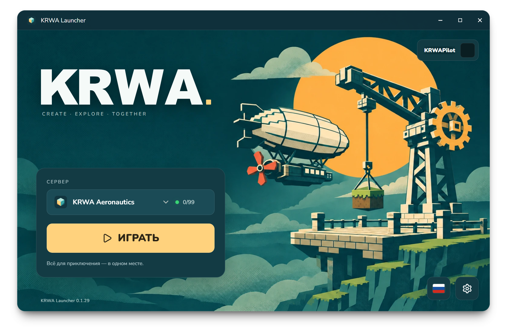
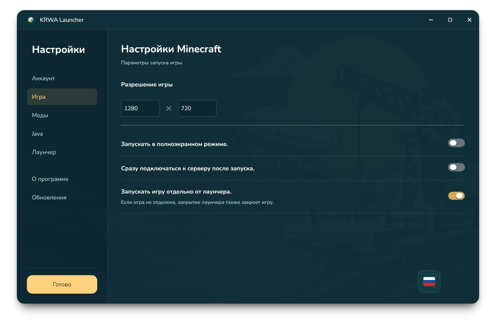

# KRWA Launcher

Открытый лаунчер Minecraft для сервера KRWA Aeronautics. Он устанавливает Java, Minecraft, NeoForge и модпак, проверяет файлы и запускает игру. [Скачать лаунчер](#скачать).

## Скриншоты

## Скачать

- [Windows 10/11 x64](https://mc.krwa.ru/download/windows)
- [Linux x64 AppImage](https://mc.krwa.ru/download/linux)
- [Linux x64 DEB для Debian/Ubuntu](https://mc.krwa.ru/download/linux-deb)
- [Steam Deck / Arch Linux x64 (pacman)](https://mc.krwa.ru/download/linux-arch)
- [macOS Universal — Intel и Apple Silicon](https://mc.krwa.ru/download/macos)

## Документация

- [Установка, обновления и Steam Deck](docs/installation.md)
- [Разработка, сборка и публикация](docs/development.md)
- [Профиль KRWA Aeronautics и обновление модпака](docs/client-profile.md)
- [Происхождение кода и сторонние компоненты](UPSTREAM.md)

Код KRWA Launcher распространяется по лицензии [MIT](LICENSE).
